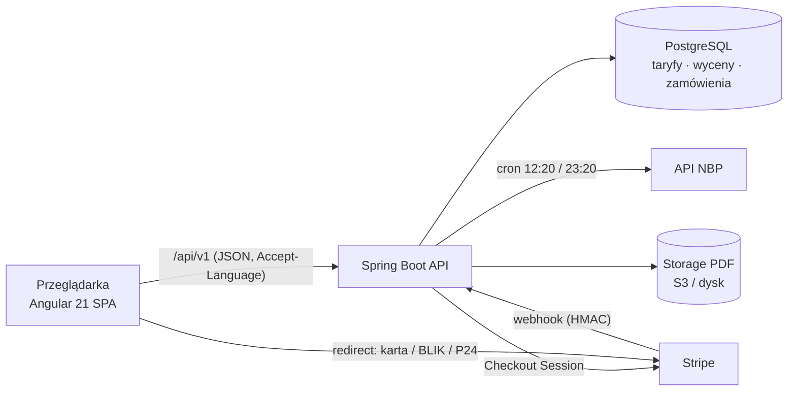
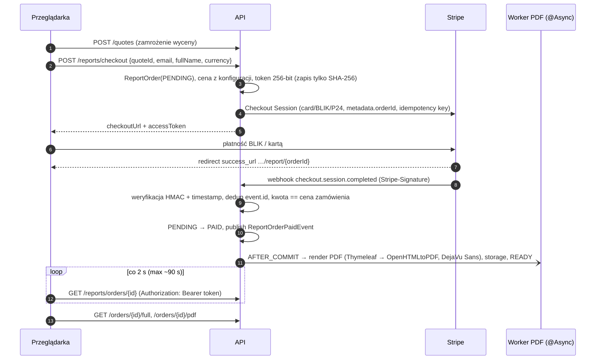

# Architektura CarImport.eu

Dokument opisuje cztery filary systemu: **model danych**, **silnik kalkulacyjny**, **frontend z Angular Signals**
oraz **i18n + płatności (Stripe → PDF)**. Każda sekcja wskazuje pliki, w których rozwiązanie jest zaimplementowane.



Moduły backendu (`backend/src/main/java/com/carimport/`):

| Pakiet         | Odpowiedzialność                                                                 |
|----------------|----------------------------------------------------------------------------------|
| `domain`       | Enumy i `Money` (BigDecimal + waluta) – bez zależności od frameworka             |
| `reference`    | Encje taryfowe + repozytoria + `JpaTariffCatalog` (cache)                        |
| `fx`           | Kursy walut, klient NBP, job synchronizacji, niezmienny snapshot `FxRates`       |
| `calculation`  | Silnik: pipeline kroków + strategie (aukcje, akcyza, VAT)                        |
| `quote`        | Zamrażanie wyceny, darmowy widok `PublicQuoteView`                               |
| `payment`      | Zamówienia raportu, Stripe Checkout, webhook                                     |
| `report`       | Lista dokumentów, render PDF, storage, API pobierania                            |
| `lead`, `affiliate` | Monetyzacja B2B: leady do partnerów, przekierowania afiliacyjne             |

---

## 1. Model danych (JPA / Hibernate)

Schemat: `db/migration/V1__schema.sql`, dane przykładowe: `V2__reference_data.sql`.
Hibernate działa w trybie `ddl-auto: validate` – źródłem prawdy jest Flyway.

```mermaid
erDiagram
    EU_PORT ||--o{ OCEAN_FREIGHT_RATE : "port docelowy"
    EU_PORT ||--o{ INTRA_EU_TRANSPORT_RATE : "z portu"
    EU_PORT }o--|| EU_COUNTRY_TAX_PROFILE : "kraj odprawy (country_code)"
    INLAND_TRANSPORT_RATE }o..o{ OCEAN_FREIGHT_RATE : "departure_port"
    QUOTE ||--o{ REPORT_ORDER : "kupiony raport"
    QUOTE ||--o{ LEAD : "przekazana wycena"
    PARTNER ||--o{ LEAD : "otrzymuje"

    AUCTION_FEE_TIER { varchar auction_house; varchar fee_type; varchar title_type; numeric price_from; numeric price_to; numeric fixed_amount; numeric percentage; varchar currency; date valid_from }
    AUCTION_FIXED_FEE { varchar auction_house; varchar origin_country; varchar code; numeric amount }
    CONDITION_SURCHARGE { varchar origin_country; varchar vehicle_condition; varchar code; numeric amount }
    EU_COUNTRY_TAX_PROFILE { varchar country_code; varchar tax_currency; numeric standard_vat_rate; numeric collector_vat_rate; bool round_to_whole_units; date valid_from }
    EXCISE_RATE { varchar country_code; varchar fuel_type; int cc_from; int cc_to; numeric rate; varchar legal_basis }
    CUSTOMS_TARIFF { varchar vehicle_category; bool historic; bool electric_only; int cc_from; varchar hs_code; numeric duty_rate }
    EXCHANGE_RATE { varchar currency; numeric pln_per_unit; date effective_date; varchar source; varchar table_no }
    QUOTE { uuid id; jsonb request_json; jsonb result_json; numeric range_min; numeric range_max; timestamptz expires_at }
    REPORT_ORDER { uuid id; varchar status; bigint amount_minor; varchar access_token_hash; varchar stripe_session_id; varchar pdf_storage_key }
```

Kluczowe decyzje:

* **Opłaty aukcyjne jako dane, nie kod.** Copart/IAAI/USS publikują drabinki opłat (`price_from`–`price_to` →
  kwota stała i/lub %), które zmieniają się kilka razy w roku. `AuctionFeeTier` przechowuje każdy próg osobno, z
  rozróżnieniem tytułu (`CLEAN`/`SALVAGE`) i typu opłaty (buyer fee, virtual bid fee, prowizja agenta).
  Opłaty płaskie (gate, environmental, recycling w Japonii) są w `AuctionFixedFee`.
* **Stawki podatkowe wersjonowane** (`valid_from`/`valid_to`) – zmiana VAT w danym kraju to nowy wiersz, a stare
  wyceny pozostają odtwarzalne. `EuCountryTaxProfile` ma osobną stawkę dla przedmiotów kolekcjonerskich (HS 9705:
  DE 7%, PL 8%, NL 9%) i flagę zaokrąglania do pełnych jednostek (Ordynacja podatkowa – PL).
* **Akcyza jako tabela** `ExciseRate` (kraj × paliwo × przedział cm³ × stawka + podstawa prawna) – dodanie
  podatku rejestracyjnego innego kraju nie wymaga migracji schematu.
* **Fracht jako przedział** `price_min`/`price_max` – na tym opiera się darmowy „widełkowy” wynik.
* **Kursy walut** w `EXCHANGE_RATE` jako „PLN za 1 jednostkę” (format tabel NBP), z numerem tabeli drukowanym w PDF.
  AED nie ma w tabeli A NBP – pochodzi z tabeli B lub jest wyliczany z peg 3,6725 AED/USD.
* **Wycena zamrożona w JSONB** (`QUOTE.result_json`) razem z użytymi kursami. Raport kupiony godzinę później pokazuje
  dokładnie te liczby, które stały za darmowym przedziałem – nawet jeśli taryfy lub kursy w międzyczasie się zmieniły.

---

## 2. Silnik kalkulacyjny

Pliki: `calculation/CalculationEngine.java`, `calculation/step/*`, `calculation/strategy/*`.

### 2.1 Wzorce

* **Pipeline (łańcuch kroków)** – `CalculationStep` z jawną kolejnością odpowiadającą kolejności prawnej. Każdy podatek
  jest podstawą kolejnego, więc kolejność jest częścią logiki biznesowej, a nie szczegółem:

  | # | Krok | Wynik |
  |---|------|-------|
  | 10 | `RoutePlanningStep` | wybór portu wyjścia (najtańsza trasa strefa → port → port UE) |
  | 20–70 | cena, opłaty aukcyjne, dopłaty za stan, transport lądowy, fracht, ubezpieczenie | składniki CIF |
  | 80 | `CustomsValueStep` | **CIF** = cena + prowizja + transport lądowy + fracht + ubezpieczenie |
  | 90 | `CustomsDutyStep` | klasyfikacja HS (8703 = 10%, 8704 = 22%, 8711 = 6–8%, 9705 = 0%) |
  | 100 | `ExciseStep` → `ExciseStrategy` **kraju docelowego** | akcyza (PL: 3,1% / 18,6% / 1,55% / 9,3% / 0%) |
  | 110 | `PortClearanceStep` | rozładunek (koszt dodatkowy w podstawie VAT) + agencja celna |
  | 120 | `ImportVatStep` → `ClearanceVatStrategy` **kraju odprawy** | VAT importowy (DE 19%, NL 21%, PL 23%) lub procedura 4200 |
  | 130–140 | laweta do kraju, opłaty rejestracyjne | koszt „pod dom” |

* **Strategy** w trzech miejscach:
  * `AuctionFeeStrategy` – `ScheduleBasedAuctionFeeStrategy` (Copart, IAAI, USS, Emirates) i `DealerPurchaseStrategy`;
  * `ExciseStrategy` – wybierana po **kraju rejestracji** (`PolishExciseStrategy`, fallback `NoNationalExciseStrategy`
    z ostrzeżeniem dla krajów z niezamodelowanym podatkiem, np. BPM w NL);
  * `ClearanceVatStrategy` – wybierana po **kraju portu**. `AbstractClearanceVatStrategy` to *Template Method*
    (podstawa → stawka → zaokrąglenie → 4200), a `German…`, `Dutch…`, `Polish…` dodają specyfikę (nazwa podatku na SAD,
    ostrzeżenia). `StandardEuClearanceVatStrategy` obsługuje każdy inny kraj z tabeli profili.
* **Port `TariffCatalog`** (hexagonal) – silnik nie zna JPA. Produkcyjnie `JpaTariffCatalog` z cache, w testach
  `InMemoryTariffCatalog`.

### 2.2 Prawo celne i podatkowe – jak jest odwzorowane

* **Waluta podatkowa = waluta kraju odprawy.** Odprawa w Bremerhaven liczy się w EUR (zaokrąglenie do centów), w Gdyni
  w PLN (zaokrąglenie do pełnych złotych). Każda linia kosztowa zachowuje kwotę oryginalną (USD/JPY…) i przeliczoną.
* **Akcyza należy do kraju rejestracji, VAT do kraju odprawy.** To ważne rozróżnienie, które upraszczające kalkulatory
  pomijają: auto odprawione w Niemczech płaci niemiecki VAT 19% od `CIF + cło + rozładunek`, a polską akcyzę płaci się
  osobno w urzędzie skarbowym (AKC-U/S, 14 dni). Akcyza wchodzi do podstawy VAT **tylko wtedy, gdy jest pobierana przez
  państwo odprawy** (odprawa w Gdyni dla auta rejestrowanego w PL) – zgodnie z art. 85–86 dyrektywy VAT.
* **Koszty dodatkowe do pierwszego miejsca przeznaczenia** (rozładunek w porcie) wchodzą do podstawy VAT, ale nie do
  wartości celnej – stąd osobna kumulacja `vatIncidentalCosts` w kontekście.
* **Procedura 4200** – tylko dla firm (walidacja `@AssertTrue` + kontrola w strategii), wymaga innego kraju odprawy niż
  docelowy. VAT importowy = 0, a VAT WNT w kraju docelowym jest wykazywany jako linia informacyjna
  (`includedInTotal = false`), bo dla czynnego podatnika jest neutralny.
* **Pojazdy zabytkowe** – 30+ lat i flaga „stan oryginalny” → HS 9705, 0% cła, obniżony VAT; ostrzeżenie o konieczności
  opinii rzeczoznawcy. Akcyza w PL nadal obowiązuje.
* **Nowy środek transportu** (≤ 6 mies. / ≤ 6000 km) odprawiony w innym kraju → ostrzeżenie, że VAT należy się też
  w kraju rejestracji.

### 2.3 Wynik darmowy vs. raport płatny

`CalculationEngine.calculateRange()` liczy trzy scenariusze (`Scenario`): **LOW** (minimalne stawki frachtu, kurs −1,5%),
**EXPECTED** (środek przedziałów), **HIGH** (maksymalne stawki, kurs +2,5%, pozycje szacunkowe +25%).

**Za darmo** (`PublicQuoteView` + `TaxSummary`) są tylko kwoty, które da się policzyć „na kartce”: cło (stawka i kwota),
VAT importowy w kraju portu (stawka, kraj, kwota), podatki kraju rejestracji (np. polska akcyza – stawka, kwota) i opłaty
portowe. **Wszystko inne** – suma od drzwi do drzwi w trzech scenariuszach, opłaty aukcyjne, fracht, dowóz (km), rejestracja,
usługi i ryzyka – jest liczone, ale serwer wysyła tylko nazwy pozycji (`lockedItems`, `risks`, `lockedCount`). Frontend
pokazuje je zamazane (rozmyte liczby są atrapą, prawdziwe kwoty nie trafiają do przeglądarki przed płatnością), z
przyciskiem zakupu na górze wyniku i stałym paskiem zakupu na telefonie.

**Ranking portów** (`POST /quotes/suggestions`) sortuje po pełnym koszcie od drzwi do drzwi, ale ujawnia dla każdego portu
tylko `TaxSummary` i dopłatę względem najtańszego (`extraVsBest`). Reguła, którą pokazuje UI (sekcja „Jak liczymy”):
cło jest takie samo w całej UE; VAT płaci się w kraju portu według jego stawki (używane auto nie płaci VAT drugi raz
w kraju rejestracji); podatki kraju rejestracji płaci się w kraju zawsze, niezależnie od portu.

**Podatek rejestracyjny kraju rejestracji** (`RegistrationTaxStep`, wzory w `RegistrationTaxes`) – trzy grupy krajów:

| Grupa | Kraje | Co robi kalkulator |
|---|---|---|
| akcyza wchodząca do podstawy VAT | PL | `PolishExciseStrategy` (stawka z tabeli, zawsze liczona) |
| brak jednorazowego podatku | BG, CZ, DE, LU, RO, SE | tylko opłaty urzędowe z `destination_fee` |
| szacunek ze wzoru | AT (NoVA 2026), BE (TMC Walonia/Bruksela), DK (registreringsafgift 2026), EE, ES (IEDMT), FI (autovero), FR (malus 2026 + taxe régionale), IE (VRT), IT (IPT), NL (BPM 2026 z tabelą amortyzacji), PT (ISV), SI (DMV) | kwota z CO₂ WLTP, mocy, wieku i wartości (CIF + cło) |
| oficjalny kalkulator | CY, GR, HR, HU, LT, LV, MT, SK | link do urzędu, użytkownik wpisuje kwotę (`registrationTaxOwn`) |

CO₂ i moc to nowe pola wizarda z propozycją (`Proposals.co2/powerKw`); własna kwota podatku zawsze wygrywa ze
szacunkiem. Wzory są uproszczone (bez dopłat wagowych, wariantów regionalnych, NOx w IE) i oznaczone w linii
parametrem `method` – przy zmianie stawek na nowy rok aktualizuje się tylko `RegistrationTaxes` + test.

**VIN → dane auta** (`GET /api/v1/vehicle/vin/{vin}`, pakiet `vehicle`): `Vin` offline sprawdza format, cyfrę
kontrolną (obowiązkową dla aut z Ameryki Płn. – łapie literówki), rocznik (10. znak + reguła cyklu z 7. znaku), markę
(WMI) i kraj produkcji. `NhtsaVinClient` (vPIC, darmowe) dodaje model, wersję, nadwozie → kategorię, pojemność,
cylindry, paliwo/elektryfikację, moc i masę (masa własna albo ¾ środka klasy GVWR). `EpaCo2Client` szuka CO₂ w bazie
EPA (rok + marka → modele zaczynające się od nazwy z vPIC → warianty z tą samą pojemnością i liczbą cylindrów → średnia
`co2TailpipeGpm`, przeliczona na g/km; to wartość EPA, bliska, ale nie równa WLTP). Każde źródło jest opcjonalne:
wynik mówi, czego brakuje (`warnings`), a pola, których źródła nie podają, zostają propozycjami kalkulatora. Wyniki
trzyma ograniczony cache LRU (5 000 VIN-ów; błędy sieci nie są cache'owane). Adresy: `app.vehicle.vpic-url`,
`app.vehicle.epa-url` (puste = źródło wyłączone). Masa własna to nowe pole wizarda (malus od wagi FR 2026, składnik
masy EE). VIN i opis auta trafiają do raportu PDF.

**Po imporcie** (`V5__eu_after_import.sql`): dla każdego z 27 krajów obowiązkowe homologacja/badanie importowe
i opłaty rejestracyjne oraz opcjonalne usługi (oświetlenie US, reflektory RHD, karta danych/CoC, serwis, geometria,
tłumaczenia, detailing) – typowe kwoty w walucie lokalnej, `estimate = TRUE`. Krok 5 pokazuje je jako listę
„Co musisz zrobić” (podatek → opłaty → rejestracja w urzędzie z terminem → OC) i „Co możesz zrobić”.

### 2.4 Przykład policzony ręcznie (test `fullChainForPetrolAbove2000ccClearedInGdynia`)

Copart salvage, bid 10 000 USD, NJ → Newark → Gdynia, benzyna 2500 cm³, PL; kurs testowy 4,00 PLN/USD.

| Pozycja | Obliczenie | PLN |
|---|---|---:|
| Cena + opłaty aukcyjne | (10 000 + 900 + 160 + 95 + 15 + 20) × 4 | 44 760,00 |
| Transport lądowy + fracht | (150 + 1 450) × 4 | 6 400,00 |
| Ubezpieczenie 1,5% | 11 190 × 4 × 0,015 | 671,40 |
| **Wartość celna CIF** | | **51 831,40** |
| Cło 10% | zaokr. do zł | 5 183 |
| Akcyza 18,6% | (51 831,40 + 5 183 → 57 014) × 0,186 | 10 605 |
| VAT 23% | (CIF + cło + akcyza + rozładunek 1 300 = 68 919,40) × 0,23 | 15 851 |
| Rozładunek, agencja, laweta, tłumaczenia, badanie, rejestracja, recykling, przeróbka świateł | | 6 206,50 |
| **Razem „pod dom”** | | **89 676,90** |


### 2.5 Dokładny koszt „pod dom” (wersja szczegółowa)

* **Kierunek i port wyjścia** – użytkownik może wskazać konkretny port eksportowy (`departurePort`); stawki
  strefowe są uzupełniane krajowymi („*”), więc np. odbiór w New Jersey można wysłać z Savannah.
* **Dostawa z portu pod dom liczona za km** (`DeliveryStep`, tabela `road_transport_rate`):
  `koszt = max(minimum, opłata stała + km × stawka/km)`. Tryby: autotransporter, laweta, przejazd na tablicach
  tymczasowych (paliwo/km + tablice i OC krótkoterminowe jako opłata stała; tylko auta jezdne), odbiór w porcie.
  Odległość – własna albo typowa dla trasy (`intra_eu_transport_rate.distance_km`); stawka – rynkowa (widełki) albo
  własna oferta przewoźnika.
* **Po imporcie** (`DestinationFeesStep`): opłaty urzędowe zawsze (PL: badanie pojazdu sprowadzonego, pozwolenie
  czasowe, tablice tymczasowe i stałe, dowód, nalepka, opłata recyklingowa), usługi do wyboru z domyślnymi
  rekomendacjami (tłumaczenia, oświetlenie US, światło przeciwmgielne, licznik km/h, serwis, geometria, detailing,
  wycena) oraz kwoty użytkownika: naprawa i ubezpieczenie na pierwszy rok.
* **Ryzyka po drodze** (`RiskStep`, tabela `risk_factor`): postój w porcie, rewizja celna, zakwestionowanie wartości
  celnej, przesunięcie na kolejny statek, udział własny przy szkodzie, ukryte usterki (zależnie od stanu), opóźnienie
  Title / dokumentów eksportowych. Każde ma prawdopodobieństwo i widełki (kwota stała, % ceny lub stawka dzienna).
* **Trzy scenariusze**: optymistyczny (najniższe stawki, kurs −1,5%, ryzyka = 0), średni (środek widełek + ryzyka jako
  wartość oczekiwana: prawdopodobieństwo × średni koszt), pesymistyczny (najwyższe stawki, kurs +2,5%, szacunki +25%,
  ryzyka w górnej granicy). Wycena zapisuje wszystkie trzy (`quote.range_json`); raport PDF i strona raportu pokazują
  każdą pozycję w trzech kolumnach.
* **Harmonogram** (odbiór z placu, rejs, odprawa, dostawa, rejestracja) i **plan po imporcie** z terminami ustawowymi
  (`AfterImportPlanService`; PL: akcyza 14 dni, rejestracja 30 dni).
* Darmowy wynik pokazuje zaokrąglone sumy trzech scenariuszy, strukturę, czas, listę wliczonych pozycji (nazwy) i
  ryzyka z prawdopodobieństwem; kwoty pozycji są w raporcie płatnym.

---

### 2.6 Propozycje zamiast wpisywania, adres → kilometry, wszystkie porty UE

Użytkownik niczego nie musi wpisywać poza adresem dostawy. Każde opcjonalne pole żądania ma **propozycję**:
`null` = „użyj propozycji kalkulatora”, wartość = nadpisanie użytkownika, `0` = brak pozycji (np. bez naprawy).
Te same reguły stosuje silnik (gdy pole jest puste) i endpoint propozycji, więc liczba w formularzu = liczba w raporcie.

| Pole | Propozycja |
|---|---|
| port odprawy | najtańszy „od drzwi do drzwi” spośród **43 portów w 22 krajach UE** (`V4__all_eu_ports.sql`) |
| `deliveryDistanceKm` | trasa drogowa z portu pod adres (OSRM `table`, jedno zapytanie dla wszystkich portów); bez routera: linia prosta × 1,25 (`RoadDistance`); bez adresu: odległość do centrum ludnościowego kraju (`CountryCentres`) |
| `deliveryMode` | autotransporter dla auta jezdnego, laweta dla niejezdnego |
| `pricePerKm` | środek pasma rynkowego z `road_transport_rate` |
| `repairEstimate` | % ceny wg stanu i tytułu (`Proposals.repairShare`: 0 / 15 % salvage / 30 % / 40 %) |
| `insuranceEstimate` | mediana OC pierwszego roku w kraju rejestracji (`Proposals.liabilityInsurance`) |

Kwoty proponowane są pozycjami szacunkowymi (pasmo −15 % / +25 % w scenariuszach), w raporcie z dopiskiem „propozycja kalkulatora”.

**Geo** (`com.carimport.geo`): `GET /api/v1/geo/search?q=` – autouzupełnianie adresu (Nominatim, tylko kraje UE; przy braku
odpowiedzi wbudowana lista ~300 miast `geo/eu-places.json`, dopasowanie bez polskich znaków). Adresy dostawców ustawia się
w `app.geo.*` (`GEOCODER_URL`, `ROUTER_URL`; puste = tylko lokalne dane). Publiczne instancje OSM mają limity – produkcyjnie
własny Nominatim/OSRM lub dostawca komercyjny z tym samym API. Wyniki są cache’owane; każda odległość niesie `ROUTED`/`ESTIMATED`.

**Ranking portów**: `POST /api/v1/quotes/suggestions` (to samo ciało co wycena) liczy pełny silnik dla każdego portu
(scenariusz średni) i zwraca listę od najtańszej: suma zaokrąglona do 100, km, czas, oraz propozycje naprawy/OC/trybu dostawy.
Frynt trzyma port w trybie AUTO (podąża za najtańszym) do czasu, aż użytkownik wybierze inny; „Wróć do najtańszego” przywraca AUTO.
Stawki frachtu do nowych portów są wyprowadzone z linii do Rotterdamu (Gdańsk – z Gdyni) współczynnikami trasy:
Atlantyk (USA/Kanada/UK) taniej na Morze Północne, Suez (Japonia/ZEA) taniej i szybciej na Morze Śródziemne, Bałtyk – feeder.

## 3. Frontend (Angular 21: standalone, Signals, control flow, zoneless, SSG)

```
frontend/src/app/
├── app.config.ts / app.config.server.ts   zoneless, hydracja z event replay, router (input binding, anchor scrolling)
├── app.routes.ts                 '' → wykryty język; ':lang' (guard czeka na tłumaczenia) →
│                                 kalkulator (pełny ekran, bez nagłówka/stopki) | Shell: home, polityka, report
├── app.routes.server.ts          prerender stron publicznych per język; report/result/root renderowane w przeglądarce
├── core/
│   ├── api/                      api.models.ts (lustro DTO z Javy), carimport-api.ts
│   ├── i18n/                     LanguageService (signal), languageGuard, LazyJsonTranslateLoader, interceptor
│   ├── routing/paths.ts          zlokalizowane slugi + pathFor(page, lang)
│   ├── seo/seo.service.ts        title, description, canonical, hreflang, OG/Twitter, JSON-LD
│   ├── theme/theme.service.ts    jasny/ciemny (data-theme na <html>)
│   └── format/                   MoneyPipe, LocalNumberPipe, CountryNamePipe (Intl)
├── layout/                       Shell, SiteHeader (top bar, nav, język, motyw, menu mobilne), SiteFooter,
│                                 CookieConsent, LanguageMenu, ThemeToggle, Logo
├── shared/                       Icon (Lucide jako inline SVG), Flag (flag-icons SVG), CountUp
└── features/
    ├── home/                     HomePage (hero, mapa tras, usługi, jak to działa, liczby, koszty + porty, cennik,
    │                             B2B, FAQ, formularz), WorldMap (+ world-map.data.ts), ContactSection
    ├── calculator/               store + strona + 3 kroki + panel wyniku (Chart.js)
    ├── paywall/ leads/ affiliates/ report/ legal/
```

### 3.0 Strona publiczna i SEO

* **Static Site Generation** (`outputMode: "static"`): strona główna, kalkulator, „O nas”, polityka prywatności
  i poradniki są prerenderowane do HTML w 23 językach (1886 plików). Google dostaje pełną treść, nagłówki i dane strukturalne bez
  wykonywania JS; hosting to dowolny CDN. Strony osobiste (`/report/…`, `/result/…`) renderują się w przeglądarce
  i mają `noindex`.
* **Zlokalizowane adresy**: `/pl/kalkulator`, `/en/calculator`, `/de/rechner`, `/uk/kalkuliator`; przełącznik języka
  prowadzi do odpowiednika bieżącej strony, nie na stronę główną.
* **`SeoService`** ustawia per strona: `<title>`, description, canonical, `hreflang` dla 4 języków + `x-default`,
  Open Graph (`og-image.png` 1200×630) i Twitter Card oraz JSON-LD: `Organization`, `WebSite`, `WebApplication`
  (z ofertami 0 zł / 19 zł), `FAQPage` (te same 9 pytań co w sekcji FAQ), `BreadcrumbList`, `WebPage` / `AboutPage`.
* `public/sitemap.xml` (z alternatywami `xhtml:link`) i `robots.txt` (blokuje `/api`, raporty i linki wycen).
  Domena jest w `core/site.config.ts` – przy wdrożeniu zmienić ją też w sitemap.
* **Treść pod frazy**: „cło na samochód z USA”, „akcyza na auto”, „Bremerhaven czy Gdynia”, „procedura 4200” – sekcje
  objaśniające i FAQ są w prerenderowanym HTML; FAQ działa na natywnym `<details>` (dostępne, bez JS).

* **Mapa tras importu** (`WorldMap`): cały świat, bez podpisów, flag i legendy – tylko UE na niebiesko, porty i
  animowane trasy. Kontury państw z Natural Earth (world-atlas, domena publiczna) jako
  buforowany sprite `public/map/world.svg` (86 kB, ok. 30 kB po gzip) wstawiany przez `<use>`, więc dziedziczy kolory
  motywu. Trasy morskie (przez Panamę, Suez, Gibraltar, Skagerrak) i porty są w kodzie i trafiają do prerenderu;
  animacja przepływu i „statki” (`animateMotion`) mają prędkość proporcjonalną do czasu rejsu. Dane generuje `node tools/generate-world-map.mjs` (zmiana portów lub tras = ponowne uruchomienie).
* **Poradniki SEO** (`features/guides`): ~78 podstron na język × 23 języki = 1794 strony + 92 strony główne
  (razem 1886 prerenderowanych adresów, wszystkie w `sitemap.xml`):
  * huby: import według kraju zakupu, kraje UE, porty odprawy (`/pl/import-auta`, `/pl/kraje-ue`, `/pl/porty`);
  * 5 poradników „import z …” (`/pl/import-auta/stany-zjednoczone`, `/de/auto-import/vereinigte-staaten`) pisanych
    pod kraj czytelnika (`LanguageInfo.home`: tytuł „…do Polski”/„…nach Deutschland”, VAT, podatek rejestracyjny,
    najbliższe porty z kilometrami; EN i UA – perspektywa całej UE);
  * 27 poradników krajów UE (VAT, waluta, lokalna nazwa podatku rejestracyjnego, urzędu i badania z
    `country-facts.ts`, najbliższe porty, terminy);
  * 43 poradniki portów (opłaty, VAT, czasy rejsu z każdego kraju pochodzenia, odległości do krajów UE, porty obok).
  Dane (porty, VAT, czasy rejsu, odległości, zlokalizowane i transliterowane slugi) generuje
  `node tools/generate-guide-data.mjs` z migracji Flyway – te same liczby, których używa kalkulator. Każda strona ma
  własny title/description, canonical, hreflang (23 języki + x-default), JSON-LD Article + FAQPage + BreadcrumbList
  (+ Country/Place z GeoCoordinates) oraz CTA do kalkulatora z parametrami (`?from=USA`, `?to=DE`, `?port=DEBRV`).
  Teksty: klucze `guide.*` (165 na język) z placeholderami w mianowniku, żeby odmiana w językach fleksyjnych była poprawna.
* **Pozycjonowanie**: serwis jest wyłącznie kalkulatorem – nie sprzedaje ani nie sprowadza aut. Strona główna sprzedaje
  wycenę: hero („Policz import auta, zanim zalicytujesz”), *Dlaczego warto* (od ręki, niezależnie, 43 porty, scenariusze,
  koszty po imporcie, raport), *Co uwzględniamy* (5 grup, 22 pozycje), tabela porównania z liczeniem na własną rękę
  i wyceną pośrednika, mapa, liczby, *Jak to działa*, koszty i porty, cennik (trzecia kolumna to oferta B2B dla firm
  importowych), FAQ (w tym „Czy CarImport.eu sprowadza auta?”) i końcowe CTA. Każda sekcja kończy się wejściem do kalkulatora.
* **„O nas”** (`/pl/o-nas`, `/en/about`, `/de/ueber-uns`, `/uk/pro-nas`): historia, czym jesteśmy i czym nie jesteśmy,
  źródła danych, jawny model przychodów (raport, opcjonalne zapytanie do firmy importowej za zgodą, oznaczone linki partnerskie),
  wartości. JSON-LD `AboutPage`.
* **Hero**: grafika auta z przezroczystym tłem (`public/images/hero-car-{900,1600}.webp`, `srcset`) po prawej stronie,
  z animacją wjazdu (wyłączoną przy `prefers-reduced-motion`). Hero i końcowe CTA są zawsze ciemne (`theme-dark`).
  Ta sama grafika jest w `og-image.png`. Duży kafel „Dlaczego warto” pokazuje prawdziwy zrzut kalkulatora.

### 3.0.1 Design system

* Styl 1:1 z szablonu marki (autoimport.pro): tło #101011, płaskie panele #1b1b1d bez obramowań, font Montserrat,
  przyciski z cienką ramką, okrągłe strzałki, pola formularza z podkreśleniem, FAQ w wąskiej kolumnie. Jeden akcent –
  **żółty (`brand`)** zamiast fioletu; niebieski (`accent`) tylko na mapie (UE) i w wykresie.
* Kolory to **tokeny semantyczne** (`bg`, `panel`, `line`, `fg`, `muted`, `brand`, `accent`, `ink`) zdefiniowane jako
  zmienne CSS i podpięte do Tailwind 4 (`@theme inline`). Motyw jasny/ciemny = jeden atrybut `data-theme`, ustawiany
  skryptem w `index.html` przed pierwszym renderem (bez mignięcia); domyślnie według ustawień systemu.
* **Bez emoji**: ikony liniowe Lucide renderowane szablonem jako inline SVG (działa w prerenderze, bez `innerHTML`),
  flagi z `flag-icons` serwowane lokalnie z `/flags` (bez zapytań do zewnętrznych serwerów).
* Wyskakujące elementy: baner cookies (równorzędne „Akceptuję” / „Tylko niezbędne”, pokazywany dopiero po hydracji),
  modale płatności i leada, menu języka i menu mobilne (Escape / klik poza zamyka).

### 3.1 Przeliczanie na żywo – `CalculatorStore`

```ts
readonly state   = signal<WizardState>(restore());                         // jedyne źródło prawdy kreatora
readonly request = computed<CalculationRequest>(() => ({ ...this.state(), departurePort: null }));

// natychmiastowe podpowiedzi bez round-tripu
readonly exciseThresholdCrossed = computed(() => /* PL && osobowy && spalinowy/hybryda && cc > 2000 */);
readonly indicativeExciseRate   = computed(() => /* 3,1 / 18,6 / 1,55 / 9,3 / 0 */);

// signal → observable → debounce → HTTP → signal
private readonly previewState = toSignal(
  toObservable(this.request).pipe(
    debounceTime(350),
    distinctUntilChanged((a, b) => JSON.stringify(a) === JSON.stringify(b)),
    tap(() => this.frozenQuote.set(null)),            // zmiana wejścia unieważnia zamrożoną wycenę
    switchMap((req) => (this.isValid() ? this.fetchPreview(req) : of(null))),   // anuluje poprzednie żądanie
  ),
  { initialValue: null },
);

// linkedSignal trzyma ostatni poprawny wynik – UI nie „mruga” przy błędzie/ładowaniu
readonly preview = linkedSignal<PreviewState | null, PublicQuoteView | null>({
  source: this.previewState,
  computation: (current, previous) => current?.view ?? previous?.value ?? null,
});
```

Komponenty tylko czytają sygnały i wywołują `store.patch({...})`. Suwak pojemności przy przekroczeniu 2000 cm³ zmienia
kolor (zielony → czerwony), pokazuje badge „Akcyza PL: 18,6%” i animowany alert; panel wyniku „przewija” kwoty
dyrektywą `appCountUp`, a wykres Chart.js animuje łuki, bo instancja jest aktualizowana w `effect()`, nie tworzona od nowa.
Stan kreatora jest w `sessionStorage`, więc powrót z anulowanej płatności Stripe przywraca formularz.

### 3.2 UX / mikrointerakcje

* **Progresywne ujawnianie** (Angular `animate.enter` / `animate.leave`): lokalizacja placu tylko dla USA/Kanady,
  typ tytułu tylko dla Copart/IAAI, checkbox zabytku dopiero dla aut 30+, suwak pojemności znika dla EV/wodoru,
  procedura 4200 tylko dla firm; transport, kupujący i 4200 schowane w „Opcjach zaawansowanych” z jednolinijkowym
  podsumowaniem.
* Suwak pojemności z wypełnieniem i znacznikiem 2000 cm³; po przekroczeniu progu panel zmienia kolor, pojawia się
  badge „Akcyza PL: 18,6%” i ostrzeżenie. Zmiana kraju na inną walutę podstawia typową cenę w tej walucie
  (12 000 USD nie staje się 12 000 JPY).
* Przewijające się kwoty (`appCountUp`), animowany wykres, pasek postępu kroków z „ptaszkami”, przyklejony pasek
  wyniku na telefonie, `prefers-reduced-motion` respektowane, brak poziomego scrolla na 390 px.

---

## 4. i18n i płatności

### 4.1 Wielojęzyczność

* **23 języki**: urzędowy język każdego państwa UE (Irlandię i Maltę obsługuje angielski, który jest tam językiem
  urzędowym) oraz ukraiński. Jedno źródło prawdy: `core/i18n/languages.ts` (kod, nazwa natywna, locale `Intl`,
  locale Open Graph, domyślny kraj docelowy i waluta wyniku). Z niego korzystają router, prerender, hreflang,
  przełącznik języka i kalkulator (np. `/cs` startuje z Czechami i CZK, `/sv` ze Szwecją i SEK).
* **Język w URL** (`/pl`, `/cs`, `/uk`… – kody ISO 639-1; dla ukraińskiego w przełączniku etykieta „UA”), z lokalnymi
  slugami podstron (`/cs/kalkulacka`, `/fr/a-propos`, …) w `core/routing/paths.ts`. `public/sitemap.xml` generuje
  `node tools/generate-sitemap.mjs` (92 adresy z alternatywami hreflang).
  `languageGuard` ustawia język, `LanguageService.current` (signal) zasila ngx-translate, `Intl` (kwoty, liczby, nazwy
  27 krajów UE przez `Intl.DisplayNames`) i atrybut `<html lang>`.
* **ngx-translate (runtime)** zamiast natywnego `@angular/localize`: jeden build zamiast czterech i przełączanie bez
  przeładowania. Pliki `public/i18n/{lang}.json` ładuje `LazyJsonTranslateLoader` jako osobne, leniwe chunki (dynamiczny
  `import`), więc działa to identycznie w przeglądarce i podczas prerenderingu, a guard języka czeka na tłumaczenia –
  w statycznym HTML nigdy nie ma surowych kluczy.
* **Backend też jest wielojęzyczny**: `acceptLanguageInterceptor` dodaje `Accept-Language`; Spring `MessageSource`
  (`i18n/messages_*.properties`) tłumaczy błędy walidacji (ProblemDetail), PDF (Thymeleaf `#{...}`), nazwę produktu
  i locale strony Stripe Checkout.
* **Wspólne klucze domenowe**: `cost.*`, `category.*`, `warning.*`, `error.*`, `doc.*` mają te same nazwy w JSON
  frontendu i w `.properties` backendu – API zwraca klucze (`messageKey`, `warnings`, `code` linii), nie teksty.
  Test `I18nCoverageTest` pilnuje, że każdy język z `app.supported-locales` ma pełny plik `.properties`.
* **Waluty**: wynik w EUR lub walucie każdego państwa UE spoza strefy euro (PLN, CZK, HUF, RON, SEK, DKK) oraz w USD
  i GBP. Wybór w nagłówku kalkulatora (`CurrencyMenu`: flaga, kod, symbol, pełna nazwa w języku interfejsu i
  wyjaśnienie, że waluta nie zmienia podatków). Przeliczenie po stronie serwera (snapshot kursów); kwoty oryginalne
  (USD, JPY, AED…) są zachowane w raporcie. Raport jest sprzedawany w każdej z tych walut
  (`app.report.price-minor` = `REPORT_PRICE_MINOR` we froncie); BLIK/P24 tylko dla PLN (P24 też EUR), karta wszędzie.

### 4.2 Płatność → PDF (bezpieczny przepływ)



Zabezpieczenia (`payment/StripeWebhookService.java`, `report/ReportOrderController.java`):

1. **Redirect nie jest dowodem płatności** – odblokowuje wyłącznie podpisany webhook. Strona sukcesu tylko odpytuje status.
2. **Surowe body** – kontroler przyjmuje `String`, bo podpis liczony jest z dokładnych bajtów; zły podpis → 400.
3. **Idempotencja** – tabela `processed_webhook_event` (PK = id zdarzenia) + strzeżone przejścia stanów + `@Version`.
4. **Integralność kwoty** – `amount_total` i waluta z sesji muszą równać się cenie zamówienia ustalonej na serwerze.
5. **Płatności asynchroniczne** – P24 może przyjść jako `async_payment_succeeded`; `expired`/`failed`/`charge.refunded`
   zmieniają status (zwrot unieważnia dostęp).
6. **Odporność** – PDF generowany po commicie, asynchronicznie; błąd renderu nie cofa statusu PAID. `ReportGenerationTriggers`
   co 2 min ponawia zamówienia „zawieszone” (max 5 prób) – lekki zamiennik transactional outbox.
7. **Dostęp bez kont** – token w **fragmencie URL** (nie trafia do logów serwerów ani nagłówka Referer), w API przesyłany
   jako `Bearer`; w bazie tylko hash, porównanie w czasie stałym; brak zamówienia i zły token dają to samo 404.
8. **PCI** – dane karty nie dotykają naszej domeny (Stripe Checkout hostowany).

Zweryfikowane end-to-end na lokalnym Postgresie: zły podpis → 400, podrobiona kwota (100 zamiast 1900) → zamówienie
pozostaje PENDING, poprawny webhook → READY i PDF 30 KB, duplikat zdarzenia → no-op, zły token → 404.

---

## 5. Produkcja i dalszy rozwój

* **Bezpieczeństwo API**: rate-limit `/quotes/preview` i `/leads` na bramie (np. Bucket4j/Cloudflare), CORS tylko dla
  domeny SPA, CSP, Spring Security dla panelu admina (zarządzanie taryfami + `@CacheEvict` cache `tariffs`).
* **E-mail** z linkiem do raportu (w miejscu oznaczonym w `ReportGenerationService`) i powiadomienia partnerów o leadach.
* **Rozszerzenia silnika**: wzory dla krajów z grupy „oficjalny kalkulator” (HU, HR, GR, …), dopłata wagowa FR; kurs celny UE
  (miesięczny, przedostatnia środa EBC) jako osobny `RateType`; panel B2B dla partnerów z rozliczeniem prowizji.
* **SEO – dalej**: blog/poradniki per kraj i marka (long tail: „import Toyoty z USA”), strony docelowe per kraj
  pochodzenia z prerenderowanym przykładem wyceny, Search Console + monitoring Core Web Vitals.
